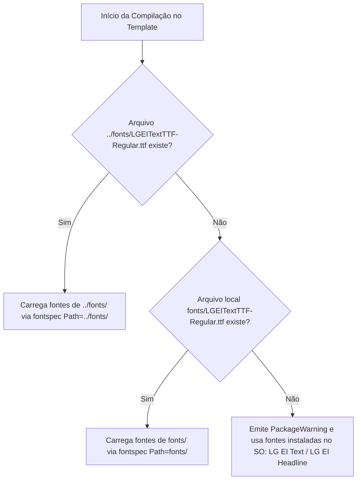

# Arquitetura Técnica do Repositório

Este documento detalha o mapa de componentes, convenções de caminhos, hierarquia tipográfica e o motor de automação do projeto.

---

## 1. Visão Geral dos Módulos

```text
templates-ax-academy-latex/
│
├── fonts/                       # Repositório global de fontes TrueType (TTF)
│   ├── LGEIHeadlineTTF-*.ttf   # Variantes da fonte de destaque (Bold, Light, Regular, Semibold, Thin, VF)
│   └── LGEITextTTF-*.ttf       # Variantes de texto corrido (Bold, Light, Regular, SemiBold)
│
├── Apostila/                    # Guia Rápido multi-página (Book)
│   ├── axacademy-guia.sty       # Design system, cabeçalhos fancyhdr, tcolorbox, títulos titlesec
│   ├── guia-rapido.tex          # Ponto de entrada com metadados (\guiatitulo, \guiasistema, etc.)
│   ├── caps/                    # Conteúdo modularizado
│   │   ├── cap01.tex            # Visão Geral e fluxo BPMN
│   │   └── cap02.tex            # Passo a passo com telas e marcadores (\passo)
│   ├── art/                     # Identidade visual vetorial
│   │   ├── fundo/               # Faixas e padrões de fundo (PDF vetorial)
│   │   └── marca/               # Logotipos da AX Academy, IFAM e do sistema
│   └── img/                     # Capturas de tela numeradas (01-login.png, etc.)
│
├── Flyer/                       # Folha única A3 paisagem
│   ├── axacademy-flyer.sty      # Layout em grade TikZ de 4 colunas x 2 linhas
│   ├── guia-flyer.tex           # Declaração dos 8 passos resumidos via \flyerpasso
│   ├── art/                     # Marcas e artes institucionais
│   └── img/                     # Telas do sistema
│
├── One-page/                    # Slide executivo corporativo
│   ├── onepagelg.sty            # Canvas geométrico TikZ 33.87 x 19.05 cm
│   ├── onepage-lg.tex           # Declarações semânticas de Antes / Depois / Resultado
│   └── img/                     # Ícones vetoriais/PNG conceituais
│
├── dist/                        # Diretório centralizado de saída dos PDFs finais
├── build.py                     # CLI de compilação, diagnóstico e limpeza
├── templates.config.json        # Arquivo de configuração de rotas e passadas
├── pyproject.toml               # Dependências do ambiente Python gerenciadas pelo uv
└── .gitignore                   # Exclusão estrita de artefatos temporários
```

---

## 2. Resolução de Fontes e Tipografia

A identidade visual utiliza a família corporativa **LG EI**.

### Como a resolução funciona em tempo de compilação:



Essa lógica garante portabilidade máxima:
- Dentro deste repositório compartilhado, a pasta raiz `fonts/` atende todos os templates sem duplicação de arquivos.
- Se uma pasta de template for isolada ou migrada, ela ainda pode receber uma pasta local `fonts/` ou usar as fontes do sistema sem quebrar.

---

## 3. Resolução de Compilador (LuaLaTeX)

O utilitário `build.py` localiza o compilador `lualatex` na seguinte ordem de prioridade:

1. **Configuração explícita:** Campo `"compiler_path"` em `templates.config.json`.
2. **Variável de Ambiente:** `LUALATEX_PATH` ou `MIKTEX_BIN`.
3. **PATH do Sistema Operacional:** Comando `lualatex` registrado no PATH.
4. **Disco Principal (C:):**
   - `C:\Program Files\MiKTeX\miktex\bin\x64\lualatex.exe`
   - `%LOCALAPPDATA%\Programs\MiKTeX\miktex\bin\x64\lualatex.exe`
   - `C:\texlive\2026\bin\windows\lualatex.exe` (e anos anteriores)
5. **Discos Opcionais/Secundários (D:, E:, etc.):**
   - `D:\MiKTeX\miktex\bin\x64\lualatex.exe`
   - `D:\texlive\2026\bin\windows\lualatex.exe`
   - `E:\MiKTeX\miktex\bin\x64\lualatex.exe`

Isso assegura que o projeto rode imediatamente tanto na máquina de desenvolvedores que instalam no `C:` padrão quanto nos que optam por partições secundárias (`D:`).

