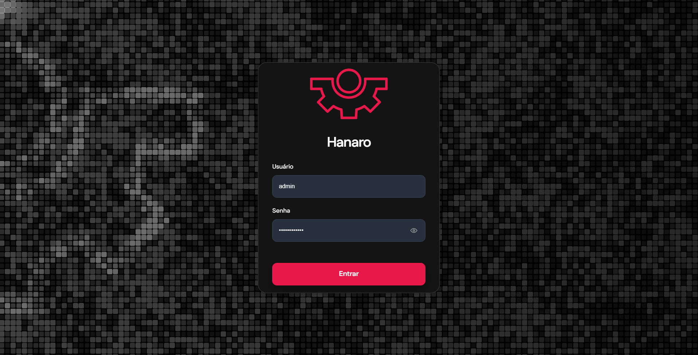

# Guia do Usuário — Sistema Hanaro

## Apresentação e Perfis de Acesso

Este guia apresenta o funcionamento prático de todas as telas do sistema **Hanaro**, orientando passo a passo as rotinas diárias de controle de refugo (*scrap*), acompanhamento de metas financeiras (*IF Cost*), investigação de causas, gestão de planos de ação e configuração de alertas.

As telas e menus visíveis para cada colaborador dependem do seu **Cargo (Perfil de Acesso)** cadastrado no sistema:

| Perfil de Acesso | Quem Utiliza | Telas Disponíveis no Menu Lateral |
| :--- | :--- | :--- |
| **Analista** | Equipe operacional e técnica de Qualidade e Manufatura | **Dashboard**, **Base de Scrap**, **Relatórios**, **Alertas**, **Ajuda e suporte** e **Perfil** |
| **Gestor** | Líderes de área, coordenadores e gerentes industriais | Todas as telas do Analista, além de aprovação de tarefas em validação, gestão de **Configurações** da planta e **Execuções** |
| **Administrador (Admin)** | Responsáveis pela administração do sistema e integrações | Acesso administrativo às rotinas de **Uso da plataforma**, **Execuções**, **Usuários**, **Alertas**, **Integrações (Microsoft Teams)** e caixa de entrada de **Suporte** |

## Capítulo 1 — Acesso ao Sistema e Gestão da Conta

### 1.1. Tela de Login

#### 1. Objetivo da Tela
Permitir que o colaborador entre no sistema Hanaro com seu usuário e senha individuais. Deve ser utilizada por todos os colaboradores no início do expediente ou quando a sessão for encerrada por inatividade.

#### 2. Pré-requisitos
* Possuir usuário e senha ativos cadastrados pela administração do sistema.

#### 3. Passo a Passo de Uso
1. Abra o endereço do sistema Hanaro no navegador. A tela inicial de acesso será exibida no centro da página.

*Figura 1 — Tela inicial de acesso ao sistema Hanaro*
2. Clique no campo **Usuário** e digite sua identificação de acesso (por exemplo, `leandrodemo`).
3. Clique no campo **Senha** e digite sua senha pessoal.
4. Caso queira conferir se digitou a senha corretamente, clique no **ícone de olho** no canto direito do campo **Senha** para mostrar ou ocultar os caracteres.
5. Clique no botão rosa **Entrar** para acessar o sistema.

#### 4. Campos da Tela

| Nome do Campo | Obrigatório | Formato | Descrição e Regra de Preenchimento |
| :--- | :--- | :--- | :--- |
| **Usuário** | Sim | Texto (letras minúsculas e números) | Identificação única do colaborador no sistema. |
| **Senha** | Sim | Texto oculto por pontos | Senha pessoal de acesso. Possui botão lateral com ícone de olho para exibir ou ocultar o texto digitado. |

#### 5. Mensagens do Sistema e Solução de Problemas

| Mensagem Exibida | Causa Provável | Como Resolver |
| :--- | :--- | :--- |
| **Informe o nome de usuário e a senha.** | Você clicou em **Entrar** deixando o campo **Usuário** ou **Senha** em branco. | Preencha os dois campos antes de clicar em **Entrar**. |
| **Nome de usuário ou senha incorretos.** | O usuário não existe, está desativado ou a senha foi digitada com algum erro. | Clique no ícone de olho para conferir a senha digitada. Se continuar sem acesso, solicite a redefinição de senha ao Administrador. |
| **Caps Lock ativado.** | A tecla de letras maiúsculas (*Caps Lock*) do teclado está ativada enquanto você digita a senha. | Desative a tecla *Caps Lock* do teclado e digite a senha novamente. |
| **Muitas tentativas...** | Foram feitas várias tentativas seguidas com senha incorreta. | Aguarde alguns minutos pelo desbloqueio automático antes de tentar novamente. |
| **Não foi possível entrar. Verifique a conexão e tente novamente.** | O computador está sem comunicação com a rede da empresa ou o sistema está temporariamente indisponível. | Verifique sua conexão de rede e tente acessar novamente em instantes. |

### 1.2. Meu Perfil e Sessões Ativas

#### 1. Objetivo da Tela
Permitir que qualquer colaborador consulte seus dados cadastrais, atualize sua foto de identificação, ative o recebimento de avisos pessoais no Microsoft Teams e encerre acessos abertos em outros computadores.

#### 2. Pré-requisitos
* Estar conectado ao sistema.
* Para trocar a foto de identificação, possuir uma imagem salva no computador nos formatos `JPEG`, `PNG` ou `WebP` com tamanho máximo de **5 MB**.

#### 3. Passo a Passo de Uso
1. No canto inferior esquerdo do menu lateral, clique sobre o seu **Nome e Cargo** (por exemplo, `Leandro Lima — Gestor`) para abrir a tela **Perfil**.

*Figura 2 — Tela de Perfil do colaborador e gerenciamento de sessões conectadas*
2. Na parte superior, confira seus dados de identificação: **Nome completo**, **Usuário** e **E-mail da conta**.
3. Na seção **Contato e trabalho**, confira o seu **Cargo** e acione a chave **Receber meus alertas no Teams** caso queira ativar ou desativar o envio de avisos diretos para o seu Microsoft Teams.
4. Para atualizar sua foto de identificação:
   * Clique no botão **Alterar foto** à direita do seu nome e escolha uma imagem do computador (`JPEG`, `PNG` ou `WebP` de até **5 MB**).
   * Aguarde a confirmação em verde **Foto atualizada com sucesso.** logo abaixo dos botões.
   * Caso queira apagar a foto atual, clique em **Remover foto**.
5. Na seção **Sessões ativas**, confira os computadores e navegadores conectados à sua conta (o computador em uso aparece sinalizado em verde como **Este dispositivo**).
6. Clique em **Atualizar** para recarregar a lista de acessos ou clique em **Encerrar sessão** ao lado de um acesso para desconectá-lo imediatamente.

#### 4. Campos da Tela

| Nome do Campo | Obrigatório | Formato | Descrição e Regra de Preenchimento |
| :--- | :--- | :--- | :--- |
| **Nome completo** | Somente leitura | Texto | Nome completo do colaborador cadastrado pela administração. |
| **Usuário** | Somente leitura | Texto iniciado por `@` | Identificação utilizada pelo colaborador para entrar no sistema. |
| **E-mail da conta** | Somente leitura | Endereço de e-mail | E-mail corporativo vinculado à conta do colaborador. |
| **Receber meus alertas no Teams** | Não | Chave liga/desliga | Ativa o envio de alertas individuais para o seu Microsoft Teams quando houver um destino pessoal cadastrado. |
| **Cargo** | Somente leitura | Texto (`Analista`, `Gestor` ou `Admin`) | Indica o nível de permissão do colaborador no sistema. |
| **Foto de identificação** | Não | Imagem (`JPEG`, `PNG` ou `WebP` até 5 MB) | Foto exibida no menu lateral e nos registros de atividades do colaborador. |
| **Sessões ativas** | Somente leitura | Lista de dispositivos | Mostra navegador, sistema operacional, data/hora do último acesso e endereço de rede de cada sessão aberta. |

#### 5. Mensagens do Sistema e Solução de Problemas

| Mensagem Exibida | Causa Provável | Como Resolver |
| :--- | :--- | :--- |
| **Foto atualizada com sucesso.** | A nova foto escolhida foi salva corretamente. | Nenhuma ação necessária (mensagem de confirmação). |
| **Use uma imagem JPEG, PNG ou WebP de até 5 MB.** | O arquivo escolhido está em outro formato (como PDF ou BMP) ou pesa mais de 5 MB. | Escolha uma imagem `.jpg` ou `.png` menor que 5 MB e clique novamente em **Alterar foto**. |
| **Nenhum destino pessoal configurado** | A chave do Teams está visível, mas ainda não há um canal pessoal vinculado ao seu usuário. | Solicite ao Administrador o cadastro do seu destino individual na tela de **Integrações > Microsoft Teams**. |

## Capítulo 2 — Configurações e Parametrizações Operacionais

### 2.1. Painel Geral de Configurações (Tema Visual e Idioma)

#### 1. Objetivo da Tela
Permitir ao usuário escolher entre o tema visual claro ou escuro, alterar o idioma de exibição do sistema (Português, Inglês ou Coreano) e acessar os seis painéis de regras e cadastros operacionais da fábrica.

#### 2. Pré-requisitos
* Estar conectado ao sistema e acessar o menu lateral **Configurações**.

#### 3. Passo a Passo de Uso
1. No menu lateral esquerdo, clique em **Configurações** (ícone de engrenagem).

*Figura 3 — Tela geral de Configurações com seleção de tema visual, idioma e regras do sistema*
2. No quadro superior esquerdo (**Tema da interface**):
   * Clique sobre o cartão **Claro** (recomendado para ambientes muito iluminados) ou **Escuro** (recomendado para reduzir o cansaço visual).
   * Você também pode usar a chave **Tema escuro** logo abaixo ou ativar **Usar configuração do sistema** para acompanhar automaticamente o modo claro/escuro do seu computador.
3. No quadro superior direito (**Idioma do sistema**), clique sobre o idioma desejado para traduzir todos os menus e títulos da plataforma:
   * **Português (BR)**;
   * **English** (Inglês);
   * **한국어** (Coreano).
4. Na parte inferior (**Dados e regras do sistema**), clique sobre o cartão que deseja consultar ou atualizar:
   * **Classificações de Material**;
   * **Tipos de Scrap**;
   * **IF Cost**;
   * **Dados de produção**;
   * **Programa do ano**;
   * **Cotação do dólar**.

#### 4. Campos da Tela

| Nome do Campo | Obrigatório | Formato | Descrição e Regra de Preenchimento |
| :--- | :--- | :--- | :--- |
| **Tema da interface (`Claro` / `Escuro`)** | Sim | Seleção visual / Chave liga/desliga | Altera imediatamente as cores de fundo e textos de todas as telas. |
| **Usar configuração do sistema** | Não | Chave liga/desliga | Faz o Hanaro seguir automaticamente o tema claro ou escuro configurado no Windows/Mac. |
| **Idioma do sistema** | Sim | Seleção única (`Português (BR)`, `English`, `한국어`) | Define o idioma em que todos os botões, menus e títulos são exibidos para você. |

#### 5. Mensagens do Sistema e Solução de Problemas

| Mensagem Exibida | Causa Provável | Como Resolver |
| :--- | :--- | :--- |
| **Menus e textos do sistema aparecem em Coreano (`한국어`) ou Inglês** | Outro idioma foi selecionado acidentalmente no quadro superior direito de Configurações. | Clique no último item com ícone de engrenagem no menu lateral esquerdo e selecione a primeira opção do quadro superior direito (**Português (BR)**). |

### 2.2. Classificações de Material

#### 1. Objetivo da Tela
Traduzir os códigos contábeis e de itens importados do sistema GERP em nomes claros e definir quais contas entram ou ficam fora do cálculo de *IF Cost* no Dashboard, na Base de Scrap e nos Relatórios. Deve ser operada por **Gestores** e **Administradores**.

#### 2. Pré-requisitos
* Ter realizado ao menos uma importação de relatório do GERP para que o sistema identifique eventuais códigos novos sem regra.

#### 3. Passo a Passo de Uso
1. Em **Configurações**, clique no cartão **Classificações de Material**.

*Figura 4 — Tela de Classificações de Material com códigos pendentes e regras cadastradas*
2. Na seção superior **Códigos sem regra**, verifique se há códigos recém-importados do GERP que ainda não possuem tradução completa:
   * Filtre por **Tipo**, **Situação**, **Falta**, **Registros** ou digite no campo **Buscar por código**.
   * Na linha do código pendente (por exemplo, `COV45678901`), clique no botão **Criar regra** à direita para cadastrar o nome ou classificação faltante.
   * Clique em **Verificar de novo** sempre que quiser atualizar a lista de pendências.
3. Na seção inferior **Regras**, consulte e edite as regras já cadastradas:
   * Use o seletor **Tipo** ou o campo **Buscar por código ou resultado** para localizar uma regra.
   * Clique no botão rosa **+ Nova regra** para cadastrar uma tradução manualmente, ou use os ícones de **lápis** (editar) e **lixeira** (excluir) na lateral direita de cada linha.
4. **Importante:** Novas regras criadas valem automaticamente para as próximas importações. Para atualizar os lançamentos que já foram importados no passado, clique no botão **Reaplicar ao histórico**.

#### 4. Campos da Tela

| Nome do Campo | Obrigatório | Formato | Descrição e Regra de Preenchimento |
| :--- | :--- | :--- | :--- |
| **Filtros de Códigos sem regra (`Tipo`, `Situação`, `Falta`, `Registros`)** | Não | Campos de seleção | Ajudam a localizar códigos vindos do GERP que ainda estão sem nome do item ou sem conta classificada. |
| **Tipo (da Regra)** | Sim | Campo de seleção (ex.: `Conta do IF Cost`, `Nome do item`) | Indica qual informação do arquivo GERP será traduzida pela regra. |
| **Código de origem** | Sim | Texto exato do GERP | Código original vindo do relatório GERP (por exemplo, `DEFECT - DIRECT CHARGED` ou `CONSUMABLE SUPPLIES EXPENSE`). |
| **Resultado** | Sim | Texto / Classificação | Define o nome amigável do item ou se a conta **Entra no IF Cost** / fica **Fora do IF Cost**. |

#### 5. Mensagens do Sistema e Solução de Problemas

| Mensagem Exibida | Causa Provável | Como Resolver |
| :--- | :--- | :--- |
| **Códigos antigos continuam sem classificação no Dashboard após criar uma regra nova** | A regra foi salva, mas ainda não foi aplicada aos lotes importados anteriormente. | Clique no botão **Reaplicar ao histórico** no topo da lista de **Regras**. |

### 2.3. Tipos de Scrap

#### 1. Objetivo da Tela
Manter a lista padronizada de categorias de defeito ou perda (como `Montagem`, `Componente`, `Processo`, `Oxidação`, `Avaria de transporte`) que os analistas escolhem ao analisar uma ocorrência na Base de Scrap.

#### 2. Pré-requisitos
* Possuir acesso ao menu **Configurações**.

#### 3. Passo a Passo de Uso
1. Em **Configurações**, clique no cartão **Tipos de Scrap**.

*Figura 5 — Tela de cadastro e gerenciamento de Tipos de Scrap*
2. No quadro **Novo tipo de scrap**, digite o **Nome \*** da nova categoria (por exemplo, `Oxidação` ou `Avaria de transporte`).
3. Confira o campo **Código \*** preenchido automaticamente a partir do nome (utilizando letras maiúsculas, números, `_` ou `-`). Caso queira ajustá-lo, faça isso antes de adicionar, pois **o código não poderá ser alterado depois**.
4. Clique no botão rosa **+ Adicionar tipo**.
5. Na tabela inferior **Tipos cadastrados**, acompanhe as categorias existentes:
   * Use a chave na coluna **Disponível nas análises** para liberar ou ocultar aquele tipo de scrap nos formulários de novas análises.
   * Use o ícone de **lápis** para renomear a categoria ou o ícone de **lixeira** para removê-la.

#### 4. Campos da Tela

| Nome do Campo | Obrigatório | Formato | Descrição e Regra de Preenchimento |
| :--- | :--- | :--- | :--- |
| **Nome \*** | Sim | Texto livre | Nome da categoria exibido para toda a equipe durante a análise de ocorrências. |
| **Código \*** | Sim | Letras maiúsculas, números, `_` ou `-` | Identificador fixo da categoria (ex.: `MONTAGEM`, `PROCESSO`). Não pode ser alterado após a criação. |
| **Disponível nas análises** | Sim | Chave liga/desliga | Controla se a categoria aparece como opção para novos registros na Base de Scrap. |

#### 5. Mensagens do Sistema e Solução de Problemas

| Mensagem Exibida | Causa Provável | Como Resolver |
| :--- | :--- | :--- |
| **Campo Código bloqueado durante a edição de um tipo existente** | Por segurança do histórico de relatórios já emitidos, o código identificador é fixo após a criação. | Se precisar de um código diferente, desative a chave **Disponível nas análises** do item antigo e crie um novo tipo. |

### 2.4. Metas Anuais e Mensais de IF Cost

#### 1. Objetivo da Tela
Definir as metas mensais de *IF Cost* em dólares (`US$`) para o ano, permitindo distribuir os valores automaticamente pelos 12 meses para comparação direta com o custo de scrap no Dashboard.

#### 2. Pré-requisitos
* Contas contábeis do *IF Cost* já classificadas em **Configurações > Classificações de Material**.

#### 3. Passo a Passo de Uso
1. Em **Configurações**, clique no cartão **IF Cost** para abrir a janela de metas.

*Figura 6 — Janela de configuração da meta anual e mensal de IF Cost*
2. No campo **Ano**, selecione o ano de planejamento (por exemplo, `2026`).
3. No quadro **Meta do ano**, confira a soma automática (**Total planejado**, **Média mensal** e variação **Em relação ao ano anterior**). Para ver quais contas entram nessa soma, clique em **Ver contas do IF Cost >**.
4. Para preencher rapidamente os 12 meses pelo assistente **Preencher os 12 meses**:
   * Escolha entre **Reduzir de janeiro a dezembro** (calcula uma queda gradual mês a mês) ou **Mesmo valor todo mês** (repete um valor único nos 12 meses).
   * Preencha a **Meta de janeiro** (ex.: `$12,000.00`) e a **Meta de dezembro** (ex.: `$6,000.00`).
   * Clique no botão **✓ Preencher tabela** para distribuir os valores nos 12 cartões mensais abaixo.
5. Se necessário, ajuste manualmente o valor de qualquer mês (`Jan.` a `Dez.`) clicando direto na caixa do respectivo mês.
6. Role até o final da janela e clique em **Salvar metas** para gravar os números.

#### 4. Campos da Tela

| Nome do Campo | Obrigatório | Formato | Descrição e Regra de Preenchimento |
| :--- | :--- | :--- | :--- |
| **Ano** | Sim | Ano (`AAAA`) | Define o ano das metas de *IF Cost*. |
| **Modo de preenchimento** | Não | Botões de opção | Escolhe entre redução progressiva de janeiro a dezembro ou valor fixo mensal. |
| **Meta de janeiro / Meta de dezembro** | Não | Valor em Dólar (`US$`) | Valores inicial e final usados pelo botão **✓ Preencher tabela**. |
| **Valores de `Jan.` a `Dez.`** | Sim | Valor em Dólar (`US$`) | Meta financeira de *IF Cost* de cada mês do ano. |

#### 5. Mensagens do Sistema e Solução de Problemas

| Mensagem Exibida | Causa Provável | Como Resolver |
| :--- | :--- | :--- |
| **Os valores calculados para os 12 meses não ficaram gravados ao fechar a janela** | O botão **✓ Preencher tabela** apenas preenche os campos na tela; é necessário confirmar a gravação no final da janela. | Após clicar em **✓ Preencher tabela**, role até o rodapé da janela e clique em **Salvar metas**. |

### 2.5. Dados de Produção Mensal

#### 1. Objetivo da Tela
Registrar o valor financeiro produzido (em dólares) e a quantidade de peças fabricadas em cada mês. O Dashboard e os Relatórios utilizam esses números para calcular a taxa de refugo em relação à produção (*Scrap Rate*).

#### 2. Pré-requisitos
* Ter em mãos os números de fechamento mensal de produção da fábrica.

#### 3. Passo a Passo de Uso
1. Em **Configurações**, clique no cartão **Dados de produção**.

*Figura 7 — Janela de lançamento mensal de Dados de produção*
2. Escolha o **Escopo** (`Global (todos os produtos)` ou um produto específico) e o **Ano** (`2026`).
3. Na barra horizontal de meses (`jan.` a `dez.`), clique sobre o mês que deseja lançar ou revisar (por exemplo, `abr.` para **Abril 2026**). Os meses já preenchidos exibem um ponto verde abaixo do nome.
4. Preencha os campos do mês selecionado:
   * **Valor da produção (USD):** Valor total produzido em dólares (ex.: `$3,376,750.00`).
   * **Quantidade produzida:** Total de unidades fabricadas no mês (ex.: `26,617`).
   * **Observação:** Anotação opcional sobre o fechamento produtivo daquele mês.
   * **Dica prática:** Pressionar a tecla `Enter` avança rapidamente do campo de valor para o de quantidade e, em seguida, para o próximo mês.
5. Confira no rodapé o resumo acumulado (**Valor no ano**, **Quantidade no ano** e **Detalhado por produto**).
6. Clique no botão rosa **✓ Salvar dados de 2026** para gravar (ou em **Limpar 2026** se precisar apagar todos os lançamentos do ano).

#### 4. Campos da Tela

| Nome do Campo | Obrigatório | Formato | Descrição e Regra de Preenchimento |
| :--- | :--- | :--- | :--- |
| **Escopo** | Sim | Campo de seleção | Define se o lançamento é do total da fábrica (`Global`) ou por linha de produto. |
| **Ano** | Sim | Ano (`AAAA`) | Ano de referência da produção. |
| **Valor da produção (USD)** | Sim | Valor em Dólar (`US$`) | Base utilizada pelo sistema para calcular o percentual financeiro de *Scrap Rate*. |
| **Quantidade produzida** | Sim | Número inteiro | Total de peças produzidas no mês selecionado. |
| **Observação** | Não | Texto livre | Comentário opcional sobre eventos produtivos daquele mês. |

#### 5. Mensagens do Sistema e Solução de Problemas

| Mensagem Exibida | Causa Provável | Como Resolver |
| :--- | :--- | :--- |
| **Diferença entre "Valor no ano" e "Detalhado por produto"** | A soma dos valores lançados por produto está diferente do valor lançado no escopo Global. | Confira o indicador percentual abaixo do campo de observação e ajuste os valores para que fechem em 100% antes de salvar. |

### 2.6. Programa do Ano

#### 1. Objetivo da Tela
Preencher a ficha anual do programa de redução de scrap da fábrica. As informações salvas nesta tela compõem automaticamente a abertura executiva dos relatórios exportados no ano.

#### 2. Pré-requisitos
* Metas de *IF Cost* do ano já salvas (para que o sistema apresente a referência automática do indicador).

#### 3. Passo a Passo de Uso
1. Em **Configurações**, clique no cartão **Programa do ano**.

*Figura 8 — Parte superior da tela Programa do ano com Identificação e KPI*
2. Selecione o ano no topo (ex.: `2026`) e observe a indicação em verde de ficha salva (ex.: `Ficha salva · versão 1`).
3. Na seção **Identificação**, preencha:
   * **Tema** (ex.: `Reduzir o custo de IF Cost em 15% sobre o realizado do ano anterior`);
   * **Período** (ex.: `Jan/2026 a Dez/2026`);
   * **Equipe** (ex.: `Qualidade e Manufatura`);
   * **Local** (ex.: `Planta de Manaus`).
4. Na seção **KPI**, o sistema já utiliza automaticamente o valor da base e das metas cadastradas. Preencha os campos **Indicador**, **Nível atual**, **Meta** e **Nota da meta** apenas se desejar substituir manualmente o texto automático (para retornar ao padrão do sistema, clique em **Voltar ao automático**).
5. Role a página para baixo até as seções **Plano de execução** e **Organização**:

*Figura 9 — Parte inferior da tela Programa do ano com Plano de execução e Organização*
6. Em **Plano de execução** (permite cadastrar até **6 etapas**):
   * Preencha para cada linha o nome da **Etapa** (ex.: `Mapear causas`), o **Período** (ex.: `Jan–Fev/2026`) e **O que é feito** (ex.: `Análise das ocorrências relevantes.`).
   * Clique em **+ Adicionar etapa** para incluir uma nova linha ou no ícone de **lixeira** para remover uma etapa.
7. Em **Organização**, informe os responsáveis pelo programa: **Patrocinador**, **Responsável**, **Líder**, participantes em **Tempo integral** e participantes em **Tempo parcial**.
8. Clique no botão rosa **✓ Salvar ficha** no canto inferior direito.

#### 4. Campos da Tela

| Nome do Campo | Obrigatório | Formato | Descrição e Regra de Preenchimento |
| :--- | :--- | :--- | :--- |
| **Tema / Período / Equipe / Local** | Não | Texto livre | Identificação geral do programa anual. Campos deixados em branco não aparecem no relatório impresso. |
| **Indicador / Nível atual / Meta / Nota da meta** | Não | Texto livre | Em branco, usa os valores automáticos das metas do ano; preencha apenas se quiser substituir manualmente. |
| **Plano de execução (`Etapa`, `Período`, `O que é feito`)** | Não | Lista de até 6 etapas | Descreve as fases do cronograma anual de redução de scrap. |
| **Organização (`Patrocinador`, `Responsável`, `Líder`, `Tempo integral`, `Tempo parcial`)** | Não | Texto livre | Registra a liderança e os integrantes dedicados ao programa. |

#### 5. Mensagens do Sistema e Solução de Problemas

| Mensagem Exibida | Causa Provável | Como Resolver |
| :--- | :--- | :--- |
| **Não é possível adicionar mais etapas no Plano de execução** | O limite máximo de 6 etapas da ficha anual já foi atingido. | Agrupe atividades semelhantes dentro das 6 etapas disponíveis. |

### 2.7. Cotação do Dólar

#### 1. Objetivo da Tela
Consultar a cotação diária de venda do dólar (PTAX do Banco Central) usada para converter valores nos envios manuais de relatórios e permitir ajustes manuais de taxa quando necessário.

#### 2. Pré-requisitos
* Possuir acesso ao menu **Configurações**.

#### 3. Passo a Passo de Uso
1. Em **Configurações**, clique no cartão **Cotação do dólar**.

*Figura 10 — Janela de consulta e ajuste da Cotação do dólar*
2. Use as setas ao lado do ano (`< 2026 >`) para escolher o período desejado.
3. Confira na tabela a **Data**, a taxa **R$ por US$** (com 4 casas decimais, ex.: `5.1500`) e a **Origem** (`Automação` quando atualizada pelo Banco Central).
4. Se precisar definir manualmente a taxa de um dia específico, clique no ícone de **lápis** na coluna **Ações** daquela data, digite o valor desejado e salve. O valor digitado manualmente terá prioridade sobre a cotação automática.

#### 4. Campos da Tela

| Nome do Campo | Obrigatório | Formato | Descrição e Regra de Preenchimento |
| :--- | :--- | :--- | :--- |
| **Data** | Somente leitura | Data (`AAAA-MM-DD`) | Data do lançamento. Em sábados, domingos e feriados, o sistema utiliza automaticamente a cotação do dia útil anterior. |
| **R$ por US$** | Sim (ao editar) | Número decimal (4 casas, ex.: `5.1500`) | Taxa de conversão de 1 dólar para reais. |
| **Origem** | Somente leitura | Texto (`Automação` / Manual) | Mostra se a cotação veio da atualização automática do Banco Central ou se foi digitada por um usuário. |

#### 5. Mensagens do Sistema e Solução de Problemas

| Mensagem Exibida | Causa Provável | Como Resolver |
| :--- | :--- | :--- |
| **Lançamento de sábado ou domingo usou a cotação de sexta-feira** | Em fins de semana e feriados não há boletim PTAX, por isso o sistema aplica automaticamente a taxa do último dia útil anterior. | Comportamento padrão do sistema. Se precisar de outra taxa para aquela data, clique no ícone de lápis da linha e digite o valor manualmente. |

## Capítulo 3 — Execuções e Atualização de Dados GERP

### 3.1. Histórico de Rotinas e Cargas

#### 1. Objetivo da Tela
Acompanhar o histórico de todas as cargas de dados importadas do sistema GERP, conferindo horários, tempo de processamento, quantidade de linhas recebidas, válidas ou rejeitadas e a confirmação de que os dados já estão publicados no sistema.

#### 2. Pré-requisitos
* Possuir perfil **Gestor** ou **Administrador** com acesso ao menu **Execuções**.

#### 3. Passo a Passo de Uso
1. No menu lateral esquerdo, clique em **Execuções** (ícone de relógio).

*Figura 11 — Tela de Execuções e atualização com o Histórico de rotinas processadas*
2. Na tabela **Histórico de rotinas**, confira o resultado de cada importação:
   * **EXECUTION ID / PROCESSO:** Código da rotina (ex.: `EXE-5887DF37`) e nome da carga;
   * **ORIGEM** (`GERP`) e **GATILHO** (`Manual` ou automático);
   * **INÍCIO**, **FIM** e **DURAÇÃO** do processamento;
   * **RECEBIDOS**, **VÁLIDOS** e **REJEITADOS** (quantidade de registros lidos e aproveitados);
   * **SNAPSHOT** (`Publicado`) e **STATUS** (`Concluído`).
3. Caso queira localizar uma carga específica por data ou status, clique no botão **Filtrar** no canto superior direito da tabela.

#### 4. Campos da Tela

| Nome do Campo | Obrigatório | Formato | Descrição e Regra de Preenchimento |
| :--- | :--- | :--- | :--- |
| **EXECUTION ID / PROCESSO** | Somente leitura | Código identificador | Número único de registro da rotina de importação. |
| **RECEBIDOS / VÁLIDOS / REJEITADOS** | Somente leitura | Número inteiro | Total de linhas enviadas no arquivo, quantas entraram na base e quantas apresentaram falha. |
| **SNAPSHOT / STATUS** | Somente leitura | Indicadores visuais (`Publicado`, `Concluído`) | Confirmam se os dados daquela carga já estão atualizados no Dashboard e na Base de Scrap. |

#### 5. Mensagens do Sistema e Solução de Problemas

| Mensagem Exibida | Causa Provável | Como Resolver |
| :--- | :--- | :--- |
| **Coluna REJEITADOS com número maior que zero (`> 0`)** | Algumas linhas do arquivo exportado do GERP estavam incompletas ou com formato inválido. | Clique sobre a linha da rotina para verificar o motivo da rejeição, corrija a extração no GERP e envie o arquivo novamente. |

### 3.2. Envio Manual de Relatório GERP

#### 1. Objetivo da Tela
Permitir o envio manual do arquivo `Other Account Transaction Text` exportado do GERP para atualizar imediatamente a Base de Scrap e os gráficos do Dashboard.

#### 2. Pré-requisitos
* Ter exportado do GERP o relatório `Other Account Transaction Text` no formato **TSV** (texto separado por tabulação, codificação `UTF-8` ou `CP1252`).

#### 3. Passo a Passo de Uso
1. Na tela **Execuções e atualização**, clique no botão rosa **+ Enviar relatório** no canto superior direito.
2. A janela **Atualizar base por relatório** será exibida no centro da tela.

*Figura 12 — Janela para selecionar e processar manualmente o relatório GERP*
3. Clique no quadro central **Selecionar relatório GERP** e escolha o arquivo `.tsv` salvo no seu computador.
4. Clique no botão rosa **Processar relatório** e aguarde a conclusão da carga na tabela **Histórico de rotinas**.

#### 4. Campos da Tela

| Nome do Campo | Obrigatório | Formato | Descrição e Regra de Preenchimento |
| :--- | :--- | :--- | :--- |
| **Selecionar relatório GERP** | Sim | Arquivo `.tsv` (`UTF-8` ou `CP1252`) | Arquivo original `Other Account Transaction Text` exportado do GERP. |

#### 5. Mensagens do Sistema e Solução de Problemas

| Mensagem Exibida | Causa Provável | Como Resolver |
| :--- | :--- | :--- |
| **Arquivo recusado ou falha ao processar relatório** | Foi selecionado um arquivo em formato incorreto (como `.xlsx` ou `.pdf`) ou uma planilha com colunas diferentes do padrão do GERP. | Exporte novamente o relatório `Other Account Transaction Text` do GERP em formato `.tsv` e repita o envio. |

## Capítulo 4 — Base de Scrap e Análise de Ocorrências

### 4.1. Consulta, Ordenação e Filtros da Base de Scrap

#### 1. Objetivo da Tela
Consultar todas as ocorrências de refugo importadas para o sistema, permitindo ordenar por data ou valor, filtrar por status de análise e localizar rapidamente os itens que precisam de investigação técnica.

#### 2. Pré-requisitos
* Estar conectado ao sistema e acessar o menu lateral **Base de Scrap**.

#### 3. Passo a Passo de Uso
1. No menu lateral esquerdo, clique em **Base de Scrap**.

*Figura 13 — Tela principal da Base de Scrap listando as ocorrências importadas*
2. No topo da tabela **Ocorrências de scrap**, confira o totalizador de registros, o valor acumulado em dólares (`US$`) e a quantidade total de peças.
3. Para mudar a ordenação da lista, clique no primeiro campo de seleção no topo da tabela (por padrão em **Data da transação**) e escolha como deseja ordenar:
   * **Data da transação**, **Organização**, **Código do item**, **Quantidade** ou **Valor (USD)**, combinando com o botão ao lado para ordem **Decrescente** ou **Crescente**.

*Figura 14 — Opções de ordenação da tabela de Ocorrências de scrap*
4. Para filtrar pelo andamento das análises, clique no seletor de status (por padrão em **Todos**) e escolha entre:
   * **Não analisado** (ocorrências aguardando análise);
   * **Rascunho** (análises iniciadas e salvas parcialmente);
   * **Revisado** (análises concluídas).

*Figura 15 — Filtro rápido por Status da análise na Base de Scrap*
5. Para aplicar filtros avançados de fábrica e linha, clique no botão **Filtrar** à direita para abrir o painel **Filtros da base**:

*Figura 16 — Painel de Filtros da base aberto na categoria Produção*
   * Navegue pelas categorias laterais **Geral**, **Catálogo**, **Produção** (`Produção`, `Departamento`, `Divisão`, `Filtro da linha` e `Linha`) e **Análise**.
   * Clique no botão rosa **Aplicar** para filtrar a tabela ou em **Limpar filtros** para voltar a ver todos os itens.

#### 4. Campos da Tela

| Nome do Campo | Obrigatório | Formato | Descrição e Regra de Preenchimento |
| :--- | :--- | :--- | :--- |
| **Ordenar por** | Não | Campo de seleção | Organiza a tabela por `Data da transação`, `Organização`, `Código do item`, `Quantidade` ou `Valor (USD)`. |
| **Status da análise** | Não | Campo de seleção | Filtra entre `Todos`, `Não analisado`, `Rascunho` e `Revisado`. |
| **Ordem (`Decrescente` / `Crescente`)** | Não | Botão alternador | Inverte a listagem do maior para o menor ou do mais recente para o mais antigo. |
| **Filtros da base (`Geral`, `Catálogo`, `Produção`, `Análise`)** | Não | Painel de filtros | Permite restringir a consulta por linha de produção, departamento, item ou analista responsável. |

#### 5. Mensagens do Sistema e Solução de Problemas

| Mensagem Exibida | Causa Provável | Como Resolver |
| :--- | :--- | :--- |
| **Algumas ocorrências não aparecem na tabela** | Há um filtro ativo no painel **Filtrar** ou o seletor de status não está marcado em **Todos**. | Clique em **Filtrar > Limpar filtros** e selecione **Todos** no filtro de status da análise. |

### 4.2. Preenchimento e Finalização de Análise de Scrap Individual

#### 1. Objetivo da Tela
Registrar a investigação técnica de uma ocorrência de scrap em 7 etapas (O problema, Onde e quando, Causa, Risco e responsabilidade, Custo, Contenção imediata e Evidências/fotos), permitindo salvar como rascunho ou finalizar a análise.

#### 2. Pré-requisitos
* Categorias de scrap já cadastradas em **Configurações > Tipos de Scrap**.

#### 3. Passo a Passo de Uso
1. Na tabela da **Base de Scrap**, clique sobre uma ocorrência com status **Não analisado** ou **Rascunho** para abrir a janela **Análise de Scrap — Ocorrência**.

*Figura 17 — Seções 1 (O problema) e 2 (Onde e quando) do formulário de Análise de Scrap*
2. Preencha a seção **1 — O problema**:
   * **Título da análise \*:** Digite um resumo curto e direto do defeito ou causa.
   * **Descrição e causa raiz \*:** Descreva o que aconteceu, as causas identificadas e as ações tomadas (até 20.000 caracteres).
3. Preencha a seção **2 — Onde e quando**:
   * Informe a **Data** (`AAAA/MM/DD`), **Hora**, **Turno**, **Linha** e **Configuração da linha**.
4. Role a janela para baixo para preencher as seções **3 — Causa** e **4 — Risco e responsabilidade**:

*Figura 18 — Seções 3 (Causa) e 4 (Risco e responsabilidade) do formulário de Análise de Scrap*
   * Em **3 — Causa**, escolha o **Tipo de scrap \*** (ex.: `Montagem`), clique no botão da **Categoria 4M da causa** (`Mão de obra`, `Máquina`, `Material`, `Método` ou `Outro`), descreva a **Causa analisada** e selecione a **Situação da causa** (ex.: `Hipótese` ou confirmada).
   * Em **4 — Risco e responsabilidade**, selecione o **Nível de risco** (`Não avaliado`, `Baixo`, `Moderado`, `Alto` ou `Crítico`), preencha **Onde/como (segmentação)** (ex.: `Empilhamento na saída da linha`) e a **Área responsável** (ex.: `Montagem` ou `Qualidade`).
5. Continue rolando até as seções **5 — Custo**, **6 — Contenção imediata** e **7 — Evidências e fotos**:
   * Em **5 — Custo**, informe o **Tipo de custo (IF Cost)** (ex.: `Retrabalho`), a **Moeda** e a **Quantidade** (se deixar em branco, o sistema usa a quantidade original da base).
   * Em **6 — Contenção imediata**, registre o que foi feito na hora para conter o problema na linha.
   * Em **7 — Evidências e fotos**, arraste fotos ou clique na área de envio para anexar até **8 imagens** (`JPEG`, `PNG` ou `WebP`, com até **10 MB** por foto).
6. No rodapé da janela, escolha como deseja gravar:
   * Clique em **Salvar rascunho** para guardar o que já preencheu e continuar depois.
   * Clique no botão rosa **Finalizar relatório** quando a análise estiver concluída.
7. Na caixa de confirmação **Finalizar análise** (*"O relatório será finalizado e continuará editável apenas por quem o criou. Deseja continuar?"*), clique novamente em **Finalizar relatório**.

*Figura 19 — Confirmação de finalização da análise e seção de Evidências e fotos*
8. Após finalizada, a análise recebe a etiqueta verde **Revisado** e passa a exibir o resumo estruturado da ocorrência, liberando no rodapé o botão **+ Criar relatório desta análise** e no topo os ícones para **Salvar como modelo favorito (`♡`)** ou **Editar (`✎`)**.

*Figura 20 — Visualização resumida de uma ocorrência com análise finalizada (Revisado)*

#### 4. Campos da Tela

| Nome do Campo | Obrigatório | Formato | Descrição e Regra de Preenchimento |
| :--- | :--- | :--- | :--- |
| **Título da análise \*** | Sim | Texto curto | Resumo breve que identifica a análise nas listas e relatórios. |
| **Descrição e causa raiz \*** | Sim | Texto longo (até 20.000 caracteres) | Detalhamento completo da ocorrência, causas e ações imediatas. |
| **Data / Hora / Turno / Linha** | Não | Data (`AAAA/MM/DD`), Hora e Seletores | Identificam o momento e o local da linha onde ocorreu a perda. |
| **Tipo de scrap \*** | Sim | Campo de seleção | Categoria escolhida dentre os **Tipos de Scrap** ativos. |
| **Categoria 4M da causa** | Não | Botões de opção (`Mão de obra`, `Máquina`, `Material`, `Método`, `Outro`) | Classifica a natureza da causa para análise nos relatórios. |
| **Situação da causa / Nível de risco** | Não | Seletor e Botões de opção | Indicam se a causa ainda é uma hipótese e qual a gravidade do risco (`Baixo` a `Crítico`). |
| **Onde/como (segmentação) / Área responsável** | Não | Texto livre | Detalham o posto ou etapa da linha e o setor responsável pela tratativa. |
| **Tipo de custo (IF Cost) / Quantidade** | Não | Seletor e Número | Classificam o custo; quando a quantidade fica vazia, o sistema adota a quantidade da base. |
| **Contenção imediata** | Não | Texto livre | Ação imediata executada no turno para interromper a perda. |
| **Evidências e fotos (`0/8`)** | Não | Envio de imagens (`JPEG`, `PNG`, `WebP`) | Permite anexar até **8 fotos** de no máximo **10 MB** cada. |

#### 5. Mensagens do Sistema e Solução de Problemas

| Mensagem Exibida | Causa Provável | Como Resolver |
| :--- | :--- | :--- |
| **● Alterações não salvas** (no canto inferior esquerdo) | Você alterou informações na tela, mas ainda não clicou em **Salvar rascunho** nem em **Finalizar relatório**. | Clique em **Salvar rascunho** ou **Finalizar relatório** antes de fechar a janela. |
| **O relatório será finalizado e continuará editável apenas por quem o criou. Deseja continuar?** | Aviso de segurança informando que, após finalizar, apenas o autor da análise poderá editá-la. | Clique em **Finalizar relatório** para confirmar. Caso outro colega ainda precise complementar dados antes, cancele e use **Salvar rascunho**. |
| **Imagem recusada em Evidências e fotos** | A foto ultrapassa 10 MB, não está em `JPEG`/`PNG`/`WebP` ou já existem 8 fotos anexadas. | Reduza o tamanho da imagem ou remova uma das 8 fotos antes de enviar outra. |

### 4.3. Modelos Favoritos e Aplicação de Análise em Lote

#### 1. Objetivo da Tela
Permitir que o analista salve uma análise recorrente como **Modelo Favorito** e aplique esse mesmo preenchimento de uma só vez a várias ocorrências semelhantes da Base de Scrap.

#### 2. Pré-requisitos
* Ter ao menos uma ocorrência já revisada (para salvar um modelo novo) ou um modelo já salvo na lista de **Modelos Salvos**.

#### 3. Passo a Passo de Uso
1. **Para salvar uma análise como Modelo Favorito:**
   * Abra uma ocorrência já **Revisada** e clique no **ícone de coração (`♡`)** no canto superior direito da janela.
   * Na caixa **Salvar como modelo favorito**, digite um nome fácil de identificar no campo **Defina um nome de referência para este modelo:** (por exemplo, `Exemplo de análise` ou `Exemplo de análise favoritada`).

*Figura 21 — Janela Salvar como modelo favorito com definição do nome de referência*

*Figura 22 — Ajuste do nome de referência em Salvar como modelo favorito*
   * Clique no botão rosa **Salvar**.
2. **Para escolher um modelo e ativar a seleção em lote:**
   * Na tela da **Base de Scrap**, clique no botão superior **Aplicar Modelo**.
   * No quadro **Modelos Salvos**, localize o modelo desejado e clique no botão rosa **✓ Usar este modelo** (ou clique em **Editar modelo** / **Excluir** se precisar alterar ou apagar o modelo).

*Figura 23 — Painel de Modelos Salvos aberto e modo de aplicação em lote ativado*
3. Com o modo de lote ativo, marque as caixas de seleção à esquerda das ocorrências da tabela que tiveram o mesmo problema (por exemplo, 2 ou 3 ocorrências).

*Figura 24 — Seleção de múltiplas ocorrências na tabela para aplicação do modelo*
4. Clique no botão rosa **Aplicar modelo aos itens selecionados** na barra superior da tabela.
5. Na janela **Aplicar Modelo em Lote**, confira a quantidade de itens marcados, o **TIPO DE SCRAP** e a **DESCRIÇÃO E CAUSA RAIZ** que serão aplicados, e confirme clicando no botão rosa **Aplicar modelo aos itens selecionados**:
   * Exemplo de confirmação com 2 ocorrências selecionadas:

*Figura 25 — Confirmação de aplicação de modelo em lote para 2 ocorrências selecionadas*
   * Exemplo de confirmação com 3 ocorrências selecionadas:

*Figura 26 — Confirmação de aplicação de modelo em lote para 3 ocorrências selecionadas*
6. Aguarde a confirmação final **✓ Relatórios criados com sucesso:** e clique no botão rosa **Fechar**.

*Figura 27 — Mensagem de conclusão após criar análises em lote com sucesso*

#### 4. Campos da Tela

| Nome do Campo | Obrigatório | Formato | Descrição e Regra de Preenchimento |
| :--- | :--- | :--- | :--- |
| **Nome de referência para este modelo** | Sim | Texto curto | Nome que identifica o modelo dentro da lista **Modelos Salvos**. |
| **Caixas de marcação da tabela** | Sim (no modo lote) | Seleção múltipla | Marcam quais linhas da Base de Scrap receberão o preenchimento automático do modelo. |

#### 5. Mensagens do Sistema e Solução de Problemas

| Mensagem Exibida | Causa Provável | Como Resolver |
| :--- | :--- | :--- |
| **Ocorrências inativas ou que já possuem relatório serão ignoradas.** | Entre os itens marcados na tabela, existe algum registro que já possui relatório vinculado. | Mensagem preventiva normal: o sistema aplicará o modelo apenas às ocorrências pendentes e preservará intactas as que já têm relatório. |
| **✓ 3 Relatórios criados com sucesso:** | O modelo foi aplicado com sucesso a todas as ocorrências válidas selecionadas. | Clique em **Fechar** para voltar à tabela atualizada. |

## Capítulo 5 — Dashboard de Monitoramento e Indicadores

### 5.1. Visão Financeira (`Impacto absoluto` e `Valor monetário`) e Tabela `Target × Realizado`

#### 1. Objetivo da Tela
Acompanhar o resultado financeiro do refugo (*IF Cost* em dólares) comparado às metas mensais e anuais da planta, permitindo abrir a tabela comparativa mês a mês com as notas explicativas de fechamento.

#### 2. Pré-requisitos
* Relatórios GERP importados em **Execuções** e metas anuais cadastradas em **Configurações > IF Cost**.

#### 3. Passo a Passo de Uso
1. No menu lateral esquerdo, clique em **Dashboard**.
2. Para visualizar os indicadores financeiros em dólares, mantenha as chaves superiores desativadas (posicionadas em **Impacto absoluto** à esquerda e **Valor monetário** à direita).

*Figura 28 — Dashboard na visão financeira padrão (Impacto absoluto em Dólares)*
3. Confira os 5 cartões superiores de indicadores:
   * **Acumulado:** Total de *IF Cost* realizado no período (ex.: `US$ 94.176,73`);
   * **Target de IF Cost:** Meta acumulada até o último mês com dados (ex.: `US$ 109.020,00`);
   * **Atingimento do target:** Percentual realizado frente à meta (ex.: `115,8% ↓ — favorável`);
   * **Diferença para a meta:** Situação em relação à meta e folga em dólares (ex.: `Dentro da meta ✓ — Folga de US$ 14.843,27`);
   * **Variação de IF Cost:** Comparação percentual com o mesmo período do ano anterior (ex.: `-24,7% ↓`).
4. No gráfico **Target × realizado mensal**, clique nos botões **Mensal** ou **Semanal** para mudar a visualização do tempo, ou clique no **ícone de tabela** (ao lado do botão `Filtros` do gráfico) para abrir o quadro **Target × realizado mensal**:

*Figura 29 — Tabela detalhada Target × realizado mensal com notas explicativas por mês*
   * Consulte mês a mês os valores de **Realizado**, **Referência**, **Meta**, **Atingimento**, **Variação** e as observações de **NOTA DO MÊS**.
   * Use os botões **< Tabela anterior** e **Próxima tabela >** (`1 / 6`) para navegar pelas tabelas de todos os gráficos do Dashboard.

#### 4. Campos e Controles da Tela

| Nome do Controle | Obrigatório | Formato | Descrição e Regra de Funcionamento |
| :--- | :--- | :--- | :--- |
| **Chave `Impacto absoluto` / `Eficiência relativa`** | Não | Chave de alternância | Alterna entre valores totais (`US$` ou `Unidades`) e percentual sobre a produção (`Scrap Rate %`). |
| **Chave `Valor monetário` / `Quantidade`** | Não | Chave de alternância | Alterna a unidade de todos os gráficos entre Dólares (`US$`) e peças (`Unidades`). |
| **Botões `Mensal` / `Semanal`** | Não | Botões de opção | Mudam a divisão do gráfico temporal entre meses (`Jan–Dez`) e semanas (`W01–W52`). |
| **COMPARAR COM (na tabela)** | Não | Campo de seleção | Escolhe a base de comparação (`YTD anterior`, `Mesmo mês ano anterior` ou `Mês anterior`). |

#### 5. Mensagens do Sistema e Solução de Problemas

| Mensagem Exibida | Causa Provável | Como Resolver |
| :--- | :--- | :--- |
| **Meta (`Target`) aparece zerada nos cartões e no gráfico** | As metas mensais do ano selecionado ainda não foram salvas em **Configurações > IF Cost**. | Acesse **Configurações > IF Cost**, preencha as metas dos 12 meses e clique em **Salvar metas**. |

### 5.2. Visão de Eficiência Relativa (`Scrap Rate`)

#### 1. Objetivo da Tela
Analisar o custo de scrap proporcionalmente ao volume produzido em cada mês (**Scrap Rate de IF Cost**), permitindo comparar meses de diferentes volumes produtivos na mesma base percentual.

#### 2. Pré-requisitos
* Valores mensais de produção cadastrados em **Configurações > Dados de produção**.

#### 3. Passo a Passo de Uso
1. No canto superior esquerdo do **Dashboard**, ative a chave **Eficiência relativa**.

*Figura 30 — Dashboard com a visão de Eficiência relativa (Scrap Rate por mês e por produto)*
2. Confira os 4 cartões superiores de taxa:
   * **Acumulado (`Scrap Rate de IF Cost`):** Percentual acumulado de perda sobre a produção (ex.: `0,4655%`);
   * **IF Cost do recorte:** Valor do scrap considerado no cálculo (ex.: `US$ 94.176,73`);
   * **Material Amount:** Valor total da produção do mesmo período (ex.: `US$ 20.233.132,00`);
   * **Variação da taxa:** Diferença percentual contra o mesmo acumulado do ano anterior (ex.: `+1,9% ↑`).
3. Acompanhe a evolução mensal no gráfico **Scrap Rate de IF Cost por mês** e compare as linhas de produto no gráfico **Produtos com maior Scrap Rate** (`MNT`, `BM`, `AV`, `TV`).

#### 4. Campos e Indicadores da Tela

| Nome do Indicador | Obrigatório | Formato | Descrição e Regra de Funcionamento |
| :--- | :--- | :--- | :--- |
| **Scrap Rate de IF Cost** | Somente leitura | Percentual (`0,0000%`) | Calculado dividindo o *IF Cost do recorte* pelo *Material Amount* (valor produzido). |
| **Material Amount** | Somente leitura | Valor em Dólar (`US$`) | Soma do valor de produção cadastrado para os meses e produtos filtrados. |

#### 5. Mensagens do Sistema e Solução de Problemas

| Mensagem Exibida | Causa Provável | Como Resolver |
| :--- | :--- | :--- |
| **Taxa percentual não calculada para determinado mês** | O mês consultado ainda não possui valor de produção lançado em **Configurações > Dados de produção**. | Acesse **Configurações > Dados de produção** e registre o valor produzido daquele mês. |

### 5.3. Visão por Quantidade de Peças e Comparação Temporal

#### 1. Objetivo da Tela
Acompanhar o volume físico de itens descartados ou retrabalhados em **unidades** e escolher qual período passado será usado como referência comparativa no painel.

#### 2. Pré-requisitos
* Estar na tela do **Dashboard**.

#### 3. Passo a Passo de Uso
1. No canto superior direito do **Dashboard**, ative a chave **Quantidade**.

*Figura 31 — Dashboard na visão de Quantidade física em unidades e acompanhamento semanal*
2. Confira os cartões em número de peças: **Acumulado** (ex.: `71.376 unidades`), **Quantidade de referência** (ex.: `72.147 unidades`) e **Variação da QTY Scrap** (ex.: `-1,1% ↓`).
3. Observe a curva no gráfico **Quantidade realizada semanal** (`W01` a `W52`) e a distribuição por área em **Top 10 produtos / áreas**.
4. Para alterar o período histórico de comparação, clique no seletor **`⇄ vs. YTD ant.`** na barra superior e escolha uma das opções:
   * **YTD anterior** (mesmo acumulado do ano anterior);
   * **Mesmo mês ano anterior**;
   * **Mês anterior**.

*Figura 32 — Menu de seleção do período de comparação histórica no topo do Dashboard*

#### 4. Campos e Controles da Tela

| Nome do Controle | Obrigatório | Formato | Descrição e Regra de Funcionamento |
| :--- | :--- | :--- | :--- |
| **Chave `Quantidade`** | Não | Chave de alternância | Altera a exibição dos cartões e gráficos de dólares (`US$`) para quantidade de peças (`unidades`). |
| **Período de comparação (`vs. YTD ant.`)** | Sim | Campo de seleção | Define qual período anterior serve de base para calcular as variações percentuais. |

#### 5. Mensagens do Sistema e Solução de Problemas

| Mensagem Exibida | Causa Provável | Como Resolver |
| :--- | :--- | :--- |
| **Os gráficos pararam de mostrar valores em Dólar (`US$`)** | A chave **Quantidade** no canto superior direito está ligada. | Desligue a chave **Quantidade** para voltar a ver os valores em Dólar (`US$`). |

### 5.4. Rankings `Top 10` e Filtros do Dashboard

#### 1. Objetivo da Tela
Visualizar rapidamente os 10 maiores focos de perda da fábrica (por linhas, modelos, componentes e contas ofensoras) e aplicar filtros de período, catálogo ou operação.

#### 2. Pré-requisitos
* Estar na tela do **Dashboard**.

#### 3. Passo a Passo de Uso
1. Role a tela do **Dashboard** para baixo para consultar os 4 quadros de ranking:
   * **Top 10 linhas** (ex.: `A02`, `A05`, `B01`);
   * **Top 10 modelos** (ex.: `Placa principal`, `Moldura superior`, `Tampa traseira`);
   * **Top 10 componentes** (ex.: `Module`, `PCBA`, `Cover Assembly`);
   * **Top 10 ofensores** (ex.: `D-EXPENSE`, `D-DIRECT`, `Intransit Shipment`, `A-STOCK`).

*Figura 33 — Gráficos de ranking Top 10 linhas, modelos, componentes e ofensores*
2. Para filtrar todo o painel (ou apenas um gráfico específico), clique no botão **Filtros**:

*Figura 34 — Janela de Filtros do Dashboard aberta na categoria Operação*
3. Escolha na coluna esquerda da janela **Filtros** o critério desejado:
   * **Período** (datas ou meses);
   * **Catálogo** (itens ou grupos de peças);
   * **Operação** (`Produção`, `Linha`, `Departamento` e `Filtro da linha`);
   * **Estrutura** (organização e classificação contábil).
4. Clique no botão rosa **Aplicar** para atualizar os gráficos ou em **Limpar seleção** para remover os filtros.

#### 4. Campos da Tela

| Nome do Campo | Obrigatório | Formato | Descrição e Regra de Preenchimento |
| :--- | :--- | :--- | :--- |
| **Categorias de Filtro (`Período`, `Catálogo`, `Operação`, `Estrutura`)** | Não | Campos de seleção | Permitem filtrar todo o Dashboard (botão do topo) ou apenas um gráfico individual (botão no canto do próprio gráfico). |

#### 5. Mensagens do Sistema e Solução de Problemas

| Mensagem Exibida | Causa Provável | Como Resolver |
| :--- | :--- | :--- |
| **Um gráfico específico apresenta números diferentes dos cartões principais** | Há um filtro individual aplicado somente àquele gráfico (o botão **Filtros** do gráfico fica destacado em rosa). | Clique no botão **Filtros** daquele gráfico e clique em **Limpar seleção**. |

## Capítulo 6 — Relatórios de Análise e Planos de Ação

### 6.1. Central de Relatórios

#### 1. Objetivo da Tela
Listar e organizar todos os relatórios técnicos e planos de ação da fábrica, permitindo acompanhar o status, o andamento das tarefas (`12/12`), a quantidade de análises vinculadas, o custo total do caso e o responsável.

#### 2. Pré-requisitos
* Estar conectado ao sistema e acessar o menu lateral **Relatórios**.

#### 3. Passo a Passo de Uso
1. No menu lateral esquerdo, clique em **Relatórios**.

*Figura 35 — Tela principal de Relatórios com abas de status e lista de planos*
2. Use as abas superiores (**Todos**, **Abertos**, **Em andamento** e **Fechados**) ou o botão **Filtros** à direita para localizar os relatórios desejados.
3. Confira nas colunas da tabela:
   * **RELATÓRIOS:** Código do plano (ex.: `PA-A28C9722`) e título do relatório;
   * **STATUS** (`Aberto`, `Em andamento` ou `Fechado`);
   * **TAREFAS:** Quantidade de ações concluídas em relação ao total planejado (ex.: `12/12`);
   * **ANÁLISES REVISADAS VINCULADAS:** Número de ocorrências da Base de Scrap agrupadas neste relatório;
   * **CUSTO DO CASO:** Soma em dólares (`US$`) das análises vinculadas;
   * **PRAZO** de conclusão e **RESPONSÁVEL PELO RELATÓRIO**.
4. Clique sobre qualquer linha da tabela para abrir o relatório completo, ou clique no botão rosa **+ Novo relatório** no canto superior direito para criar um novo.

#### 4. Campos da Tela

| Nome do Campo | Obrigatório | Formato | Descrição e Regra de Preenchimento |
| :--- | :--- | :--- | :--- |
| **Abas de Status (`Todos`, `Abertos`, `Em andamento`, `Fechados`)** | Não | Filtro rápido | Filtra a lista de relatórios de acordo com a situação atual de cada plano. |
| **CUSTO DO CASO** | Somente leitura | Valor em Dólar (`US$`) | Soma automática dos custos de todas as análises de scrap vinculadas ao relatório. |

#### 5. Mensagens do Sistema e Solução de Problemas

| Mensagem Exibida | Causa Provável | Como Resolver |
| :--- | :--- | :--- |
| **Um relatório existente não aparece na lista** | Alguma aba de status específica (como `Abertos` ou `Fechados`) está selecionada no topo. | Clique na aba **Todos** para exibir todos os relatórios cadastrados. |

### 6.2. Criação de Novo Relatório (Passo a Passo em 4 Etapas)

#### 1. Objetivo da Tela
Guiar a criação de um novo relatório técnico em 4 etapas simples: escolha das análises de scrap revisadas, preenchimento dos dados básicos, investigação da causa raiz pelos **5 Porquês** e registro opcional das primeiras ações.

#### 2. Pré-requisitos
* Existir ao menos **uma análise de scrap finalizada (`Revisado`)** na Base de Scrap.

#### 3. Passo a Passo de Uso
1. Na tela de **Relatórios**, clique no botão rosa **+ Novo relatório** para abrir a **ETAPA 1 DE 4 — Análises** (*"Quais análises originam este relatório?"*).

*Figura 36 — Etapa 1 de criação de Novo relatório antes da seleção das análises*
2. Use a barra de busca se necessário e marque **pelo menos uma** análise revisada da lista. Os itens marcados ficarão destacados em rosa.

*Figura 37 — Etapa 1 de criação de Novo relatório com análises selecionadas*
3. Clique no botão rosa **Continuar** para ir à **ETAPA 2 DE 4 — Dados** (*"Dados do relatório"*):

*Figura 38 — Etapa 2 de criação de Novo relatório (Título, Descrição, Responsável e Prazo)*
   * Preencha o **Título \*** do relatório (até 240 caracteres) e a **Descrição** do problema;
   * Selecione o **Responsável pelo relatório**, o **Prazo** (`AAAA/MM/DD`) e a **Etapa do plano** (ex.: `Mapeamento de causas`);
   * Clique em **Continuar**.
4. Na **ETAPA 3 DE 4 — Causa raiz** (*"Análise de causa (5 porquês)"*):

*Figura 39 — Etapa 3 de criação de Novo relatório com preenchimento dos 5 Porquês*
   * Preencha obrigatoriamente os três primeiros campos (**Porquê 1**, **Porquê 2** e **Porquê 3**) perguntando sucessivamente *"por que isso aconteceu?"* até identificar a causa raiz.
   * Se desejar detalhar mais níveis, preencha também o **Porquê 4 (Opcional)** e o **Porquê 5 (Opcional)**.
   * Clique em **Continuar**.
5. Na **ETAPA 4 DE 4 — Ações (Opcional)** (*"Ações iniciais"*):

*Figura 40 — Etapa 4 de criação de Novo relatório para inclusão opcional de ações iniciais*
   * Clique em **+ Adicionar ação** se já quiser cadastrar as primeiras tarefas agora, ou deixe para criá-las depois dentro do quadro do relatório.
   * Clique no botão rosa **Criar relatório**.

#### 4. Campos da Tela

| Nome do Campo | Obrigatório | Formato | Descrição e Regra de Preenchimento |
| :--- | :--- | :--- | :--- |
| **Análises vinculadas (Etapa 1)** | Sim (mínimo 1) | Caixas de marcação | Vincula ao relatório uma ou mais ocorrências já revisadas na Base de Scrap. |
| **Título \* (Etapa 2)** | Sim | Texto (até 240 caracteres) | Nome principal do relatório e do plano de ação. |
| **Descrição (Etapa 2)** | Não | Texto livre | Resumo do contexto e objetivo do relatório. |
| **Responsável / Prazo / Etapa do plano (Etapa 2)** | Sim | Seletores e Data (`AAAA/MM/DD`) | Definem quem responde pelo plano, a data-limite e a fase atual do trabalho. |
| **Porquê 1, Porquê 2 e Porquê 3 (Etapa 3)** | Sim | Texto livre | Os 3 primeiros porquês são obrigatórios para registrar a cadeia de causa raiz. |
| **Porquê 4 e Porquê 5 (Etapa 3)** | Não | Texto livre | Campos complementares opcionais da análise de 5 Porquês. |
| **Ações iniciais (Etapa 4)** | Não | Lista de tarefas | Permite adiantar o cadastro de ações corretivas antes de abrir o relatório. |

#### 5. Mensagens do Sistema e Solução de Problemas

| Mensagem Exibida | Causa Provável | Como Resolver |
| :--- | :--- | :--- |
| **Botão "Continuar" bloqueado na Etapa 1** | Nenhuma análise de scrap foi marcada na lista. | Marque pelo menos uma análise revisada para liberar o avanço. |
| **Botão "Continuar" bloqueado na Etapa 3** | Algum dos campos obrigatórios (**Porquê 1**, **Porquê 2** ou **Porquê 3**) está em branco. | Preencha no mínimo os 3 primeiros motivos da investigação de causa. |

### 6.3. Abas `Visão geral` e `Investigação` do Relatório

#### 1. Objetivo da Tela
Acompanhar na aba **Visão geral** os indicadores financeiros e a lista de **Prontidão do relatório** (7 itens necessários para concluir o plano) e detalhar na aba **Investigação** a causa raiz, os 5 porquês e as análises vinculadas.

#### 2. Pré-requisitos
* Estar com um relatório aberto na tela de **Relatórios**.

#### 3. Passo a Passo de Uso
1. Ao abrir um relatório, consulte na aba **Visão geral**:

*Figura 41 — Aba Visão geral do relatório com indicadores do caso e checklist de Prontidão*
   * Os 4 cartões superiores: **Custo do caso**, **Economia estimada** (clique em `Informar economia` para preencher), **Redução observada na base** (`Ver efeito >`) e **Evidências pendentes**.
   * O quadro **Prontidão do relatório (1 de 7)**: clique sobre qualquer item pendente (`Causa raiz`, `4M da causa`, `Ao menos uma tarefa`, `Medição antes e depois`, `Mês do efeito`, `Resultados qualitativos`) para ir direto ao ponto de preenchimento.
2. Clique na aba **Investigação**:

*Figura 42 — Aba Investigação do relatório com Causa raiz, 5 porquês e análises vinculadas*
   * No quadro **Causa raiz**, clique em **Editar** para registrar a definição final da causa raiz.
   * No quadro **Análise de causa (5 porquês)**, clique em **Editar plano** caso precise revisar os motivos apontados.
   * Em **Análises revisadas vinculadas**, consulte as ocorrências que compõem o relatório e clique no botão **`♡ Caso BP`** caso queira destacar uma análise como caso de boa prática na apresentação exportada.

#### 4. Campos da Tela

| Nome do Campo | Obrigatório | Formato | Descrição e Regra de Preenchimento |
| :--- | :--- | :--- | :--- |
| **Prontidão do relatório (`1 de 7` a `7 de 7`)** | Somente leitura | Lista de verificação | Indica quais etapas ainda faltam preencher para que o relatório fique completo. |
| **Causa raiz** | Sim (para conclusão) | Texto livre | Descrição definitiva da causa fundamental do problema. |
| **Botão `♡ Caso BP`** | Não | Botão de destaque | Marca a análise selecionada como estudo de caso em destaque para exportação em PDF e PowerPoint. |

#### 5. Mensagens do Sistema e Solução de Problemas

| Mensagem Exibida | Causa Provável | Como Resolver |
| :--- | :--- | :--- |
| **Itens pendentes na lista de Prontidão do relatório** | Informações de causa raiz, tarefas ou medição de resultado ainda não foram salvas nas abas correspondentes. | Clique sobre cada item desmarcado na lista **Prontidão do relatório** para abrir e preencher a seção faltante. |

### 6.4. Gestão de Tarefas (Abas `Lista`, `Quadro` e `Cronograma`)

#### 1. Objetivo da Tela
Cadastrar, atribuir responsáveis, acompanhar prazos e validar a conclusão das ações corretivas, preventivas e de contenção do relatório em três formatos de visualização: **Lista**, **Quadro** de colunas e **Cronograma** no tempo.

#### 2. Pré-requisitos
* Estar dentro de um relatório aberto.

#### 3. Passo a Passo de Uso
1. **Acompanhamento pela aba `Lista`:**
   * Clique na aba **Lista** para ver todas as tarefas em formato de tabela (`Nº`, `TAREFA`, `DEPTO`, `4M`, `ONDE / COMO`, `PEÇA`, `SINTOMA`, `RESPONSÁVEL`, `ESTADO`, `PRIORIDADE`, `SITUAÇÃO DO PRAZO`, `PRAZO`).
   * Para incluir uma tarefa rapidamente, digite o nome no campo inferior **"Título da nova tarefa e Enter"** e clique em **Adicionar**.

*Figura 43 — Aba Lista de tarefas do relatório com filtros e barra de adição rápida*
2. **Acompanhamento pela aba `Quadro`:**
   * Clique na aba **Quadro** para visualizar os cartões de tarefas distribuídos nas 4 etapas: **Planejada**, **Em andamento**, **Em validação** e **Concluída**.

*Figura 44 — Aba Quadro de tarefas do relatório com as quatro colunas de andamento*
   * Para criar uma tarefa rápida direto na coluna **Planejada**, clique em **+ Criar tarefa**, digite em **"O que precisa ser feito?"**, escolha a prioridade, a data e o responsável nos ícones abaixo do texto e pressione `Enter`.

*Figura 45 — Criação rápida de tarefa diretamente na base da coluna Planejada*
   * Quando uma tarefa estiver na coluna **Em validação**, o gestor pode aprová-la clicando no botão rosa **✓ Validar conclusão** dentro do cartão para movê-la para **Concluída**.

*Figura 46 — Cartão de tarefa na coluna Em validação com botão Validar conclusão*
3. **Cadastro completo de tarefa pelo botão `+ Nova tarefa`:**
   * Clique no botão rosa **+ Nova tarefa** no canto superior direito do relatório:

*Figura 47 — Parte superior da janela Nova tarefa (Dados da tarefa e Classificação)*
   * Em **Dados da tarefa**, informe o **Título \***, a **Descrição**, escolha o **Tipo de ação** (`Não classificada`, `Contenção`, `Corretiva` ou `Preventiva`) e a **Prioridade** (`Média`, `Alta`, etc.).
   * Em **Classificação**, você pode clicar em **▸ Reaproveitar dados de uma análise** ou preencher **4M** e **Sintoma**.
   * Role a janela para baixo até **Responsável e prazo**:

*Figura 48 — Parte inferior da janela Nova tarefa (Responsável, prazo, linhas e economia)*
   * Informe o **Responsável principal** (ex.: `Marina Costa`), a **Área responsável** (ex.: `Qualidade`), a data de **Início**, o **Prazo** de entrega, os **Participantes** e indique se a tarefa está **Sem bloqueio** ou **Bloqueada**.

*Figura 49 — Detalhe do preenchimento de Área responsável e Prazo na janela de tarefa*
   * Se desejar, expanda **Implantação por linha** (para marcar as linhas de produção atendidas) e **Economia** (para informar o ganho financeiro esperado) e clique em **Salvar**.
4. **Acompanhamento pela aba `Cronograma`:**
   * Clique na aba **Cronograma** para visualizar as barras de duração das tarefas ao longo dos meses, podendo marcar a opção **Ocultar concluídas** no canto superior direito para focar apenas no que está em aberto.

*Figura 50 — Aba Cronograma exibindo a linha do tempo de execução das tarefas*

#### 4. Campos da Tela

| Nome do Campo | Obrigatório | Formato | Descrição e Regra de Preenchimento |
| :--- | :--- | :--- | :--- |
| **Título \* (da Tarefa)** | Sim | Texto curto | Nome da ação prática que deverá ser executada. |
| **Tipo de ação** | Sim | Botões de opção (`Não classificada`, `Contenção`, `Corretiva`, `Preventiva`) | Define a finalidade técnica da tarefa no plano de ação. |
| **Prioridade** | Sim | Campo de seleção | Define o nível de urgência da tarefa (`Baixa`, `Média`, `Alta`, `Crítica`). |
| **Responsável principal / Área responsável** | Sim | Seletor de colaborador e Texto | Define quem executará a tarefa (enviando alerta automático para o responsável) e o setor correspondente. |
| **Início / Prazo** | Sim | Datas (`AAAA/MM/DD`) | Datas de início e fim previstas para a tarefa, exibidas no **Cronograma**. |
| **Situação de bloqueio (`Sem bloqueio` / `Bloqueada`)** | Não | Botões de opção | Indica se há algum impedimento travando o andamento da ação. |
| **Implantação por linha / Economia** | Não | Seções expansíveis | Registram em quais linhas a melhoria foi aplicada e a economia anual estimada. |

#### 5. Mensagens do Sistema e Solução de Problemas

| Mensagem Exibida | Causa Provável | Como Resolver |
| :--- | :--- | :--- |
| **Data em vermelho com símbolo de alerta (`⚠`) no cartão da tarefa** | O prazo final da tarefa já passou e ela ainda não foi concluída. | Atualize o andamento junto ao responsável ou edite a tarefa para ajustar o prazo caso tenha sido reprogramada. |

### 6.5. Abas `Resultado`, `Prévia` e Exportação de Documento (`PDF` e `PowerPoint`)

#### 1. Objetivo da Tela
Comprovar na aba **Resultado** a redução real de scrap após as ações (comparando os 3 meses anteriores com os 3 meses posteriores ao mês de efeito), revisar o resumo na aba **Prévia** e baixar o documento pronto em **PDF A4** ou **Apresentação PowerPoint 16:9**.

#### 2. Pré-requisitos
* Análises e plano de ação registrados no relatório.

#### 3. Passo a Passo de Uso
1. Clique na aba **Resultado** para consultar ou registrar os indicadores pós-implantação:

*Figura 51 — Aba Resultado com comparativo antes e depois e medição de efeito na base de scrap*
   * Confira a **Medição antes e depois**, o **Mês do efeito** (ex.: `mai. 2026`) e os **Resultados qualitativos**.
   * No quadro **Efeito medido na base de scrap**, analise o gráfico comparativo dos **3 meses antes** (barras cinzas) contra os **3 meses depois** (barras rosas) do mês do efeito, verificando a redução financeira mensal e a tabela comparativa **Por análise**.
   * Role a página para conferir as **evidências visuais da melhoria**:
     * **Fotos antes e depois:** compare as imagens da situação inicial com as imagens após a execução das ações. O painel apresenta até **6 pares**, selecionados entre as imagens anexadas às ações do relatório.
     * **Fotos do processo:** acompanhe os registros organizados pelas etapas **Mapeamento de causas**, **Geração de ideias**, **Execução** e **Gestão de resultados**.

*Figura 52 — Evidências visuais do relatório: fotos antes e depois e registros das etapas do processo*
2. Clique na aba **Prévia** para revisar todo o conteúdo consolidado do relatório antes de exportar.
   * Se precisar alterar os dados gerais do plano ou apagar o relatório, clique no botão de **três pontos (`⋮`)** no canto superior direito e escolha **Ver detalhes**, **Editar plano** ou **Excluir relatório**.

*Figura 53 — Aba Prévia do relatório com menu superior de ações aberto*
3. Para gerar o arquivo final para impressão ou reunião, clique no botão **Baixar documento** no canto superior direito para abrir a janela **Montar documento**:
   * **Para baixar em PDF (`PDF A4`):**

*Figura 54 — Janela Montar documento configurada para exportar relatório executivo em PDF A4*
     * Clique no cartão **PDF A4 (Relatório executivo para ler e imprimir)**.
     * Selecione o **Idioma do documento** (`Português`, `English` ou `한국어`) ou ative a chave **Traduzir o texto para inglês (IA)** no topo caso queira que o sistema traduza automaticamente os textos digitados.
     * Escolha um dos **Atalhos** (`Completo`, `Só visão executiva`, `Só casos`) ou marque nas chaves abaixo quais seções deseja incluir (`Task Charter do ano`, `Resumo e indicadores`, `Efeito medido na base`, `Por que este caso (maiores itens)`, `Gráfico de custo mensal`).
     * Confira a prévia das páginas na coluna **Estrutura** à direita e clique no botão rosa **↓ Baixar PDF**.
   * **Para baixar em PowerPoint (`Apresentação 16:9`):**

*Figura 55 — Janela Montar documento configurada para exportar Apresentação 16:9 em PowerPoint com seleção de idioma*
     * Clique no cartão **Apresentação 16:9 (Slides editáveis no PowerPoint)**, escolha o **Idioma do documento** (`Português`, `English`, `한국어`), confira a lista de slides à direita e clique no botão rosa **↓ Baixar apresentação**.
4. **Confira a apresentação gerada:** abra o arquivo baixado no PowerPoint e revise os slides antes de apresentar ou compartilhar.
   * Nos slides de casos, confira as **informações do problema**, a **causa raiz**, as **fotos de antes e depois**, as **ações executadas** e os **resultados financeiros**.
   * O exemplo abaixo apresenta o caso **Embalagem prensada na saída da linha**, reunindo o problema analisado, as ações de melhoria, a redução do custo de scrap e a economia prevista.

*Figura 56 — Exemplo de slide exportado para PowerPoint com problema, causa raiz, ações e resultados*

#### 4. Campos da Tela

| Nome do Campo | Obrigatório | Formato | Descrição e Regra de Preenchimento |
| :--- | :--- | :--- | :--- |
| **Mês do efeito (aba `Resultado`)** | Sim | Mês e Ano (`mmm. AAAA`) | Mês de referência da melhoria; serve de base para comparar os 3 meses anteriores com os 3 meses posteriores. |
| **Traduzir o texto para inglês (`IA`)** | Não | Chave liga/desliga | Traduz automaticamente para o inglês os textos abertos do relatório antes de gerar o arquivo. |
| **Formato (`PDF A4` / `Apresentação 16:9`)** | Sim | Seleção visual | Escolhe entre gerar um documento vertical em `.pdf` ou slides widescreen editáveis em `.pptx`. |
| **Idioma do documento** | Sim | Campo de seleção (`Português`, `English`, `한국어`) | Define o idioma dos títulos e rótulos do arquivo gerado. |
| **Atalhos e Chaves de Seção** | Não | Botões e Chaves liga/desliga | Permitem escolher exatamente quais blocos e gráficos entram no documento exportado. |

#### 5. Mensagens do Sistema e Solução de Problemas

| Mensagem Exibida | Causa Provável | Como Resolver |
| :--- | :--- | :--- |
| **Taxa (scrap ÷ produção) exibe "sem produção cadastrada" na aba Resultado** | Os meses usados na comparação antes/depois ainda não possuem dados de produção salvos em **Configurações > Dados de produção**. | Cadastre o volume produzido desses meses em **Configurações > Dados de produção** para que o sistema calcule a taxa relativa. |

## Capítulo 7 — Governança de Alertas e Integração com Microsoft Teams

### 7.1. Histórico de Notificações e Regras de Alerta

#### 1. Objetivo da Tela
Consultar os avisos recebidos pelo operador (como novas tarefas atribuídas, prazos vencidos ou limites de custo ultrapassados) e configurar regras automáticas para disparo de alertas no sistema e no Microsoft Teams.

#### 2. Pré-requisitos
* Estar conectado ao sistema e acessar o menu lateral **Alertas**.

#### 3. Passo a Passo de Uso
1. No menu lateral esquerdo, clique em **Alertas**.

*Figura 57 — Tela principal de Alertas com o Histórico de notificações recebidas*
2. Na tabela **Histórico de notificações**, confira os alertas disparados:
   * Verifique o **TÍTULO**, a **CLASSIFICAÇÃO** (ex.: `Tarefa atribuída` ou `Tarefa atrasada`), a **DATA**, o **STATUS** (`Aberto · Não lido`) e o **RESPONSÁVEL**.
   * Na coluna **AÇÕES**, clique em **Ver tarefa ↗** para abrir a tarefa correspondente, no ícone de **lápis** para editar ou no ícone de **confirmação (`✓`)** para marcar o aviso como lido.
3. Para criar ou alterar regras automáticas de aviso, clique no botão **Configurar alertas** no canto superior direito:

*Figura 58 — Janela Configurar alertas listando as regras de notificação cadastradas*
   * Clique em **Editar** ao lado de uma regra existente ou no botão rosa **+ Nova regra**.
4. Na parte superior da janela **Editar regra / Nova regra** (**IDENTIFICAÇÃO** e **QUANDO AVISAR**):

*Figura 59 — Parte superior do cadastro de Regra de notificação (Identificação e Quando avisar)*
   * Digite o **Nome da regra** (ex.: `Linha acima de US$ 4.000 no trimestre`), escolha o **Tipo** (ex.: `Custo acima do limite`), a **Severidade** (ex.: `Crítico`) e mantenha a chave **Habilitada** ligada.
   * Em **QUANDO AVISAR**, selecione **Avaliar custo por** (`Linha` ou `Ocorrência`), digite o **Limiar** (ex.: `4000`), selecione a **Moeda** (`USD`), informe o **Início do período** e o **Fim do período** (`AAAA/MM/DD`) e, se desejar, preencha o **Intervalo mínimo (minutos)** entre avisos.
5. Role a janela para baixo até as seções **QUEM RECEBE** e **CANAIS DE NOTIFICAÇÃO**:

*Figura 60 — Parte inferior do cadastro de Regra de notificação (Filtros, Quem recebe e Canais)*
   * *(Opcional)* Restrinja o alerta por `Organização`, `Linha`, `Part number` ou `Componente / tipo de item`.
   * Em **QUEM RECEBE**, selecione ao menos uma pessoa no campo **Pessoas** (ex.: `Leandro Lima`, `Marina Costa`) e/ou um perfil.
   * Em **CANAIS DE NOTIFICAÇÃO**, mantenha **No sistema** marcado e marque também **Microsoft Teams** se quiser que o aviso seja enviado para o Teams.
   * Clique no botão rosa **Salvar regra**.

#### 4. Campos da Tela

| Nome do Campo | Obrigatório | Formato | Descrição e Regra de Preenchimento |
| :--- | :--- | :--- | :--- |
| **Nome da regra** | Sim | Texto curto | Nome que identifica o alerta na lista de configuração. |
| **Tipo / Severidade** | Sim | Campos de seleção | Definem o motivo do disparo (`Custo acima do limite`, `Ocorrência relevante`, etc.) e a gravidade (`Informativo`, `Crítico`). |
| **Habilitada** | Sim | Chave liga/desliga | Permite pausar temporariamente uma regra sem precisar excluí-la. |
| **Avaliar custo por** | Sim | Campo de seleção (`Linha`, `Ocorrência`) | Define se o sistema soma o custo acumulado da linha ou avalia cada ocorrência individualmente. |
| **Limiar / Moeda** | Sim | Número (`>= 0`) e Moeda (`USD`) | Valor financeiro a partir do qual o alerta é disparado. |
| **Início do período / Fim do período** | Sim | Datas (`AAAA/MM/DD`) | Período de vigência da regra; a data final deve ser igual ou posterior à data inicial. |
| **QUEM RECEBE (`Pessoas` / `Perfis`)** | Sim (mínimo 1) | Seleção de usuários/perfis | Indica quem receberá a notificação quando a regra for acionada. |
| **CANAIS DE NOTIFICAÇÃO** | Sim | Caixas de marcação | O envio **No sistema** é padrão; marque **Microsoft Teams** para enviar também ao Teams. |

#### 5. Mensagens do Sistema e Solução de Problemas

| Mensagem Exibida | Causa Provável | Como Resolver |
| :--- | :--- | :--- |
| **Não é possível salvar a regra de alerta** | Falta preencher o nome da regra, escolher pelo menos um destinatário em **QUEM RECEBE**, ou a data final está menor que a data inicial. | Revise esses três campos obrigatórios e clique novamente em **Salvar regra**. |

### 7.2. Integração com Microsoft Teams

#### 1. Objetivo da Tela
Cadastrar os endereços de conexão (*Workflows*) do Microsoft Teams para que o sistema Hanaro possa enviar cartões automáticos de alerta para canais, grupos ou pessoas no Teams. Operado pelo perfil **Administrador**.

#### 2. Pré-requisitos
* Criar previamente um *Workflow* no Microsoft Teams (ou Power Automate) com o gatilho *"When a Teams webhook request is received"* liberado para *Anyone* e copiar o endereço (URL) gerado.

#### 3. Passo a Passo de Uso
1. No menu lateral esquerdo da visão administrativa, clique no ícone de globo (**Integrações**).

*Figura 61 — Tela inicial de Integrações com o Microsoft Teams antes do cadastro de destinos*
2. Leia a orientação no quadro superior e clique no botão rosa **+ Novo destino**.
3. Preencha os campos do novo destino na seção **Destinos configurados**:

*Figura 62 — Formulário de cadastro de novo destino do Microsoft Teams com idioma em Inglês*
   * **Nome do destino:** Digite um nome claro para identificar o canal ou pessoa (ex.: `Canal Qualidade`).
   * **Tipo:** Clique no seletor e escolha se o endereço pertence a uma **Pessoa**, **Grupo** ou **Canal**.

*Figura 63 — Opções do campo Tipo no cadastro de destino do Microsoft Teams (Pessoa, Grupo ou Canal)*
   * **Idioma do cartão:** Escolha em qual idioma o aviso chegará no Teams (por exemplo, **Inglês** ou **Português**).

*Figura 64 — Formulário de cadastro de novo destino do Microsoft Teams com idioma em Português*
   * **URL do webhook:** Cole o endereço copiado do *Workflow* do Microsoft Teams.
4. Mantenha a caixa **Ativo** marcada e, se quiser que este canal receba por padrão todos os alertas operacionais gerais, marque também **Destino operacional padrão**.
5. Clique no botão rosa **Salvar** e confira no topo da tela a confirmação **Workflow aceitou a solicitação; confira o cartão no Teams.**

#### 4. Campos da Tela

| Nome do Campo | Obrigatório | Formato | Descrição e Regra de Preenchimento |
| :--- | :--- | :--- | :--- |
| **Nome do destino** | Sim | Texto curto | Nome de identificação do canal, grupo ou colaborador no sistema. |
| **Tipo** | Sim | Campo de seleção (`Pessoa`, `Grupo`, `Canal`) | Define o tipo de destinatário no Microsoft Teams. |
| **Idioma do cartão** | Sim | Campo de seleção (`Português`, `Inglês`) | Define o idioma do cartão de aviso enviado ao Teams. |
| **URL do webhook** | Sim | Endereço web (`https://...`) | Link gerado pelo *Workflow* configurado no Microsoft Teams. |
| **Ativo / Destino operacional padrão** | Não | Caixas de marcação | Habilitam o envio para este endereço e definem se ele é o canal padrão da operação. |

#### 5. Mensagens do Sistema e Solução de Problemas

| Mensagem Exibida | Causa Provável | Como Resolver |
| :--- | :--- | :--- |
| **Workflow aceitou a solicitação; confira o cartão no Teams.** | O endereço foi validado com sucesso pelo Microsoft Teams. | Abra o canal ou chat no Microsoft Teams para confirmar o recebimento do cartão de teste. |

## Capítulo 8 — Suporte, Gestão de Usuários e Uso da Plataforma

### 8.1. Abertura de Chamados e Caixa de Entrada de Suporte

#### 1. Objetivo da Tela
Permitir que qualquer colaborador envie dúvidas, sugestões ou relatos de problemas diretamente pelo menu **Ajuda e suporte**, e oferecer aos Administradores uma **Caixa de entrada** para consultar as solicitações enviadas.

#### 2. Pré-requisitos
* Estar conectado ao sistema.

#### 3. Passo a Passo de Uso
1. **Para enviar uma mensagem ao suporte (qualquer colaborador):**
   * Na parte inferior do menu lateral esquerdo, clique em **Ajuda e suporte**.
   * Na janela **Fale com o suporte**, preencha o campo **Assunto** resumindo sua necessidade.

*Figura 65 — Janela Fale com o suporte para envio de dúvidas, problemas ou sugestões*
   * No campo **Como podemos ajudar?**, descreva detalhadamente sua dúvida, sugestão ou o problema encontrado (até 5.000 caracteres).
   * Clique no botão rosa **✉ Enviar solicitação**.
2. **Para consultar as mensagens enviadas (Administrador):**
   * No menu lateral esquerdo da visão administrativa, clique no ícone **Suporte**.

*Figura 66 — Tela administrativa de Solicitações de suporte (Caixa de entrada)*
   * Na tela **Solicitações de suporte**, acompanhe a lista na **Caixa de entrada** ou utilize o campo **Buscar solicitações** (*"Nome, e-mail ou assunto"*) para localizar um chamado específico.

#### 4. Campos da Tela

| Nome do Campo | Obrigatório | Formato | Descrição e Regra de Preenchimento |
| :--- | :--- | :--- | :--- |
| **Assunto** | Sim | Texto curto | Resumo do tema da solicitação. |
| **Como podemos ajudar?** | Sim | Texto longo (até 5.000 caracteres) | Explicação detalhada da dúvida, sugestão ou ocorrência. |
| **Buscar solicitações** | Não | Texto livre | Filtra a caixa de entrada do administrador por nome, e-mail ou assunto. |

#### 5. Mensagens do Sistema e Solução de Problemas

| Mensagem Exibida | Causa Provável | Como Resolver |
| :--- | :--- | :--- |
| **Nenhuma solicitação encontrada — As mensagens enviadas aparecerão nesta lista.** | Ainda não há chamados abertos ou o texto digitado na busca não encontrou correspondência. | Limpe o campo **Buscar solicitações** para ver toda a caixa de entrada. |

### 8.2. Cadastro e Gestão de Usuários

#### 1. Objetivo da Tela
Cadastrar novos colaboradores no sistema, definir seus cargos de acesso (`Analista`, `Gestor` ou `Admin`), ativar ou desativar contas e manter os dados da equipe atualizados. Tela exclusiva do perfil **Administrador**.

#### 2. Pré-requisitos
* Estar conectado com perfil de **Administrador**.

#### 3. Passo a Passo de Uso
1. No menu lateral esquerdo, clique em **Usuários** (ícone de pessoas).

*Figura 67 — Tela de Usuários listando os colaboradores cadastrados e seus cargos*
2. Confira na tabela **Usuários cadastrados** as informações de cada conta: **NOME**, **USUÁRIO**, **E-MAIL**, **GESTOR DIRETO**, **CARGO** (`Admin`, `Gestor`, `Analista`), **STATUS** (chave `Ativo`) e **AÇÕES** (editar ou excluir).
3. Para cadastrar um novo colaborador, clique no botão rosa **+ Novo usuário** no canto superior direito:

*Figura 68 — Janela Novo usuário preenchida para criação de conta de acesso*
   * **Nome:** Digite o nome completo (de **2 a 30 caracteres**).
   * **Usuário:** Digite o identificador de login (de **2 a 20 caracteres**, usando **apenas letras minúsculas e números**, sem espaços ou símbolos).
   * **E-mail:** Informe o e-mail corporativo (até **50 caracteres**).
   * **Cargo:** Escolha o perfil de acesso (`Analista`, `Gestor` ou `Admin`).
   * **Senha inicial:** Digite uma senha segura com **pelo menos 12 caracteres** que não contenha o nome, o usuário ou o e-mail do colaborador.
4. Clique no botão rosa **Criar usuário**.

#### 4. Campos da Tela

| Nome do Campo | Obrigatório | Formato | Descrição e Regra de Preenchimento |
| :--- | :--- | :--- | :--- |
| **Nome** | Sim | Texto (2 a 30 caracteres) | Nome do colaborador exibido nas telas, tarefas e relatórios. |
| **Usuário** | Sim | Letras minúsculas e números (2 a 20 caracteres) | Identificação usada no login; não aceita espaços, acentos ou letras maiúsculas. |
| **E-mail** | Sim | Endereço de e-mail (até 50 caracteres) | E-mail corporativo vinculado ao colaborador. |
| **Cargo** | Sim | Campo de seleção (`Analista`, `Gestor`, `Admin`) | Define quais telas e ações o colaborador poderá acessar. |
| **Senha inicial** | Sim | Texto oculto (12 a 72 caracteres) | Deve ter no mínimo 12 caracteres, ser difícil de adivinhar e não conter o nome, usuário ou e-mail da pessoa. |
| **STATUS (`Ativo`)** | Sim | Chave liga/desliga | Permite desativar ou reativar imediatamente o acesso do colaborador. |

#### 5. Mensagens do Sistema e Solução de Problemas

| Mensagem Exibida | Causa Provável | Como Resolver |
| :--- | :--- | :--- |
| **Aviso de senha muito simples ou fácil de adivinhar** | A senha informada tem menos de 12 caracteres, usa uma sequência muito comum ou contém partes do nome, usuário ou e-mail do colaborador. | Crie uma senha com pelo menos 12 caracteres sem repetir o nome ou login do usuário. |
| **Erro ao validar o campo Usuário ou Nome** | Foram digitadas letras maiúsculas ou espaços no campo **Usuário**, ou o **Nome** passou de 30 caracteres. | Use apenas letras minúsculas e números no campo **Usuário** e abrevie nomes intermediários se ultrapassar 30 caracteres. |

### 8.3. Uso da Plataforma e Configuração de Tempos Manuais

#### 1. Objetivo da Tela
Acompanhar o tempo economizado pela equipe com o uso do sistema Hanaro (no dia, no mês e no ano), consultar a quantidade de acessos diários e ajustar os tempos médios que cada atividade levava antes da automação. Exclusivo para **Administradores**.

#### 2. Pré-requisitos
* Estar conectado com perfil de **Administrador**.

#### 3. Passo a Passo de Uso
1. No menu lateral esquerdo da visão administrativa, clique no primeiro ícone (**Uso da plataforma**).

*Figura 69 — Painel de Uso da plataforma com tempo economizado e gráfico de acessos por dia*
2. Confira na parte superior os 3 cartões de **Tempo economizado**: **Hoje**, **Este mês** (ex.: `40h30min`) e **Este ano** (ex.: `40h30min`), comparando o `Tempo atual` com o `Tempo manual estimado`.
3. Abaixo, acompanhe os números gerais de utilização (**Acessos**, **Usuários ativos**, **Coletas concluídas** e **Relatórios gerados**) e o gráfico **Acessos por dia** (podendo alternar entre os últimos **30 dias** ou **90 dias**).
4. Para informar ou atualizar quanto tempo cada tarefa levava manualmente antes do sistema, clique no botão **⚙ Configurar** no canto superior direito para abrir a janela **Configurar tempos manuais**:

*Figura 70 — Janela Configurar tempos manuais em minutos por tarefa*
   * Informe o tempo em **minutos por tarefa** para:
     * **Preparação da coleta** (ex.: `90` minutos);
     * **Apresentação dos dados** (ex.: `45` minutos);
     * **Criação de relatório** (ex.: `120` minutos).
   * Clique no botão rosa **Salvar tempos**.

#### 4. Campos da Tela

| Nome do Campo | Obrigatório | Formato | Descrição e Regra de Preenchimento |
| :--- | :--- | :--- | :--- |
| **Preparação da coleta** | Sim | Número inteiro (`minutos por tarefa`) | Tempo que era gasto manualmente para extrair e organizar cada carga de dados antes da automação. |
| **Apresentação dos dados** | Sim | Número inteiro (`minutos por tarefa`) | Tempo que era gasto manualmente para atualizar planilhas e gráficos de indicadores. |
| **Criação de relatório** | Sim | Número inteiro (`minutos por tarefa`) | Tempo que era gasto manualmente para montar e formatar cada relatório executivo. |
| **Período do gráfico (`30 dias` / `90 dias`)** | Não | Botões de opção | Muda o período exibido no gráfico de **Acessos por dia**. |

#### 5. Mensagens do Sistema e Solução de Problemas

| Mensagem Exibida | Causa Provável | Como Resolver |
| :--- | :--- | :--- |
| **Tempo economizado marcando `0min`** | Não houve coletas ou relatórios gerados no período consultado (como `Hoje`) ou os valores em **Configurar tempos manuais** estão zerados. | Clique em **⚙ Configurar** no canto superior direito e verifique se os minutos por tarefa estão preenchidos. |

## Capítulo 9 — Modo TV

### Exibir o Modo TV

O Modo TV mostra os indicadores em tela cheia para as TVs da fábrica. Abra-o pelo botão com o ícone de tela, nos controles do Dashboard.

*Figura 71 — Modo TV na tela Fábrica com indicadores, ranking e controles de rotação*

1. Confira o **título da tela** em exibição. Na tela **Fábrica**, use **Mês** e **Ano** para escolher o período.
2. Consulte **Dados até** para conferir a data do último dado da base. Ao lado aparecem a data e a hora atuais.
3. Use **Executivo**, **Fábrica**, **Ofensores** e **Prioridades** para alternar diretamente entre as telas.
4. Use as **setas** para passar de tela, **Pausar** para interromper a rotação automática e **Intervalo** para definir o tempo de cada tela.
5. Use **Tema Claro** para alterar o fundo, **Tela cheia** para ocupar o monitor e **Sair** para retornar ao Dashboard.

**Dica:** na TV da linha, deixe a rotação automática ligada e use Tela cheia. O contador, como `2/4`, identifica a tela atual.

### Telas do Modo TV

| Botão | Título da tela | O que mostra |
| --- | --- | --- |
| **Executivo** | Visão Executiva | IF Cost acumulado, mesmo período do ano anterior, variação e target acumulado; evolução do IF Cost no ano, no ano anterior e no target; os três componentes mais afetados. |
| **Fábrica** | Ranking de ocorrências por linha | Ocorrências do período, linha com mais ocorrências, linhas monitoradas e período anterior; ranking das linhas de montagem, com a variação; setores com mais ocorrências. |
| **Ofensores** | Principais ofensores do período | Os cinco defeitos e as oito linhas de maior IF Cost; o part number e o defeito mais críticos. |
| **Prioridades** | Ocorrências prioritárias | As ocorrências críticas de maior custo, com a descrição; situação das revisões (pendentes, em revisão e justificadas) e categorias predominantes. |
